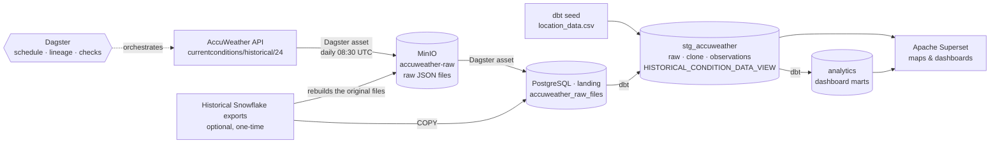

# accuweather_etl

End-to-end ETL pipeline that extracts weather observations from the **AccuWeather API**, keeps every raw
response in a **MinIO** data lake, models it with **dbt** on **PostgreSQL** and serves interactive
**Apache Superset** dashboards with world maps. **Dagster** orchestrates and schedules everything, and the whole
platform starts with a single `docker compose up -d`.

It is a portable, open-source re-implementation of a cloud pipeline (AWS Lambda + S3 + Snowflake): the same
request logic, file layout and tables (`LOCATION_DATA`, `HISTORICAL_CONDITION_RAW_DATA`,
`HISTORICAL_CONDITION_RAW_DATA_CLONE` and `HISTORICAL_CONDITION_DATA_VIEW`), running locally on Docker.

 
 
 

---

## Table of contents

1. [Architecture](#architecture)
2. [Prerequisites](#prerequisites)
3. [Quick start](#quick-start)
4. [How the ETL works, step by step](#how-the-etl-works-step-by-step)
5. [Data model](#data-model)
6. [Dashboards](#dashboards)
7. [Operating the pipeline](#operating-the-pipeline)
8. [Configuration reference](#configuration-reference)
9. [Project structure](#project-structure)
10. [Troubleshooting](#troubleshooting)
11. [License](#license)

---

## Architecture



| Service | Purpose | URL (default) |
|---|---|---|
| **Dagster** (webserver, daemon, code server) | Orchestration, daily schedule, lineage, data quality checks | http://localhost:3001 |
| **Superset 6.0** | Dashboards and maps (metadata stored in PostgreSQL) | http://localhost:8089 |
| **MinIO** | S3-compatible data lake for the raw API responses | Console http://localhost:9011 · API http://localhost:9010 |
| **PostgreSQL 17** | Warehouse (`weather`), Dagster storage (`dagster`), Superset metadata (`superset`) | `localhost:5435` |
| **pipeline-bootstrap** | One-shot, idempotent run executed on every `docker compose up -d` | – |

All ports are bound to `127.0.0.1` and can be changed in `.env`.

---

## Prerequisites

- **Docker Desktop** (or Docker Engine) with **Docker Compose v2**. Give Docker at least **6 GB of RAM** and
  **8 GB of free disk** (more if you load the 1.3 GB historical export).
- An **AccuWeather API key**: create a free app at <https://developer.accuweather.com>. The free tier is
  enough: the pipeline sends **one request per active city per day** (17 requests/day with the default cities).
- Optional: the historical Snowflake exports `historical_condition_raw_data.csv` and
  `historical_condition_raw_data_clone.csv` (August 2023 – October 2024). They are **not** in Git.

---

## Quick start

### 1. Clone the repository

```bash
git clone https://github.com/franconahuel20/accuweather_etl.git
cd accuweather_etl
```

### 2. Create the `.env` file

```bash
cp .env.example .env
```

Edit `.env` and set at least:

| Variable | Value |
|---|---|
| `ACCUWEATHER_API_KEY` | Your AccuWeather API key |
| `POSTGRES_SUPERUSER_PASSWORD`, `WAREHOUSE_PASSWORD`, `BI_READER_PASSWORD`, `DAGSTER_PG_PASSWORD`, `SUPERSET_PG_PASSWORD` | Strong passwords (letters and digits) |
| `MINIO_ROOT_PASSWORD` | At least 8 characters |
| `SUPERSET_ADMIN_PASSWORD` | Password of the Superset `admin` user |
| `SUPERSET_SECRET_KEY` | A long random string: `python -c "import secrets; print(secrets.token_urlsafe(48))"` |

`.env` is listed in `.gitignore` and `.dockerignore`: it is never committed nor copied into an image.

### 3. (Optional) Add the historical data

Copy the two CSV exports into `data/historical/` **or** point `HISTORICAL_DATA_DIR` in `.env` to the folder
that already contains them (absolute paths such as `C:/Users/me/Accuweather` work on Windows). Without them the
platform starts empty and fills up day by day.

### 4. Start everything

```bash
docker compose up -d
```

The first start builds two images (Dagster + dbt, Superset) and then:

1. PostgreSQL creates the `weather`, `dagster` and `superset` databases, their roles and schemas.
2. MinIO creates the `accuweather-raw` bucket (versioned).
3. `pipeline-bootstrap` runs the Dagster `bootstrap_job` (see the next section). With the historical export it
   takes about **7 minutes**; without it, about 1 minute.
4. Superset initialises its metadata, registers the warehouse and imports the dashboard.

Follow the bootstrap and wait for `RUN_SUCCESS`:

```bash
docker compose logs -f pipeline-bootstrap
```

### 5. Open the dashboards

Go to **http://localhost:8089**, sign in with `SUPERSET_ADMIN_USERNAME` / `SUPERSET_ADMIN_PASSWORD` and open
**Dashboards → AccuWeather · Global Weather Monitor**.

Dagster is at **http://localhost:3001** (asset lineage, runs, schedule and checks), and the MinIO console at
**http://localhost:9011** (`MINIO_ROOT_USER` / `MINIO_ROOT_PASSWORD`).

---

## How the ETL works, step by step

The Dagster asset graph (group → asset):

| Step | Dagster asset | What it does |
|---|---|---|
| 1 | `warehouse/stg_accuweather/location_data` (dbt seed) | Loads `dbt/seeds/location_data.csv` (LOCATION_DATA: cities, AccuWeather keys, time zones, coordinates, `active_bit`) and enforces its primary key `PK_CITIES`. |
| 2 | `ingestion/minio/accuweather_api_raw_json` | For every **active** city, requests `GET /currentconditions/v1/{locationKey}/historical/24?details=true` (the last 24 hourly observations), adds the location fields (`city_accuweather_id`, `city_name`, `country_iso_code`, `country_name`, `latitude`, `longitude`) and stores the response in MinIO as `currentconditions/historical/<CC>/<city>/<yyyy>_<Mon>_<dd>_<city>_<CC>.json`, named after the city's *previous* local day, exactly like the original Lambda. If the file already exists the city is **not** requested again, so reruns never waste quota. |
| 3 | `historical_backfill/minio/historical_export_raw_json` | One-time: rebuilds the 7,032 original JSON files from the Snowflake export and stores them in MinIO with their original keys and ingestion dates. Skipped when the export is absent or already loaded. |
| 4 | `historical_backfill/landing/historical_condition_raw_data_clone_export` | One-time: `COPY` of the clone export into `landing`. |
| 5 | `landing/landing/accuweather_raw_files` | Copies every new file from MinIO into PostgreSQL (`landing.accuweather_raw_files`, one JSONB row per file). |
| 6 | `warehouse/*` and `marts/*` (dbt models) | `dbt build`: appends the new observations to `HISTORICAL_CONDITION_RAW_DATA`, rebuilds the typed observations, the view `HISTORICAL_CONDITION_DATA_VIEW` and the dashboard marts, and runs every data test. |

**Jobs and schedule**

| Job | Assets | Trigger |
|---|---|---|
| `accuweather_daily_job` | 1, 2, 5, 6 | `accuweather_daily_schedule`, **every day at 08:30 UTC** (after local midnight for every city between UTC-3 and UTC-8), enabled by default. |
| `historical_backfill_job` | 1, 3, 4, 5, 6 | Manual, when new historical exports are added. |
| `bootstrap_job` | all | `pipeline-bootstrap` container on every `docker compose up -d`. |

**Data quality**

- dbt tests (shown as Dagster asset checks): primary key and unique folders of `location_data`, valid
  coordinates, not-null keys, one row per city and observation time in the view, one row per city and day in
  the daily mart, plausible temperature/humidity ranges (warning), active cities without data (warning).
- Dagster check `all_active_cities_fetched`: fails (in red, without blocking the load) when an active city has
  no file for the current day in MinIO.
- Idempotency everywhere: MinIO keys are immutable, landing keys are unique, the raw table is append-only by file,
  and the historical loads remember what they loaded.

**Changes compared with the original implementation**

- The API is called over HTTPS (`http://` now answers `301`).
- `location_data`: Brasília had `CITY_FOLDER_STR = rio_de_janeiro`, so its files overwrote Rio de Janeiro's
  (the historical data has only 24 observations for Rio). The seed now uses `brasilia`, and a test keeps folder
  names unique.
- AccuWeather's 24-hour windows can overlap (161 duplicated observations in the history). The view keeps one row
  per city and observation time.

---

## Data model

PostgreSQL database `weather` (owner `etl`):

| Schema | Object | Type | Description |
|---|---|---|---|
| `landing` | `accuweather_raw_files` | table | One row per raw JSON file from MinIO (`object_key`, `payload` JSONB, `source`, `data_ingress_date_dte`). |
| `landing` | `historical_condition_raw_data_clone_export` | table | Snowflake export of the clone table. |
| `landing` | `load_audit` | table | Which export files were loaded (size + modification time). |
| `stg_accuweather` | `location_data` | dbt seed | **LOCATION_DATA**, with primary key `pk_cities (country_iso_alpha_3_str, city_accuweather_id_str)`. |
| `stg_accuweather` | `historical_condition_raw_data` | dbt incremental | **HISTORICAL_CONDITION_RAW_DATA**: `filename_str`, `payload` (JSONB), `data_ingress_date_dte`. One row per observation, append-only. |
| `stg_accuweather` | `historical_condition_raw_data_clone` | dbt table | **HISTORICAL_CONDITION_RAW_DATA_CLONE**: point-in-time backup copy loaded from its export. |
| `stg_accuweather` | `historical_condition_observations` | dbt table | Typed, de-duplicated observations (JSON parsed once, indexed). |
| `stg_accuweather` | `historical_condition_data_view` | dbt **view** | **HISTORICAL_CONDITION_DATA_VIEW** with the original columns: `accuweather_id`, `city_name`, `country`, `country_code`, `latitude`, `longitude`, `local_obs_datetime`, `weather_text`, `cloud_cover`, `temp_c`, `real_feel_temp_c`, `temp_f`, `real_feel_temp_f`, `relative_humidity`, `pressure_metric_mb`, `pressure_imperial_inhg`, `uv_index`, `uv_index_text`. |
| `analytics` | `city_latest_conditions` | dbt table | Latest observation per city plus a 24-hour summary and a temperature band (maps, KPIs). |
| `analytics` | `city_daily_weather` | dbt table | One row per city and local day (min/mean/max temperature, humidity, UV, precipitation...). |
| `analytics` | `weather_observations` | dbt view | Hourly observations with local date/hour and grouped weather conditions. |

Superset connects with the read-only role `bi_reader`, which can read `stg_accuweather` and `analytics` but
not `landing`.

---

## Dashboards

**AccuWeather · Global Weather Monitor** (`/superset/dashboard/accuweather-weather/`), with native filters for
**Country**, **City** and **Date range**, cross-filtering, and an hourly auto-refresh.

*Current conditions* tab:
- KPIs: cities monitored, average, warmest and coldest current temperature.
- **World map** (world map with country shapes): countries coloured by the average current temperature of their cities.
- **Cities map** (deck.gl scatter on a light-gray Esri base map, no Mapbox token needed): every city at its
  latitude/longitude, coloured by temperature band (freezing → hot).
- Current conditions table (temperature, RealFeel®, 24-hour min/max, humidity, wind, UV, rain).
- Temperature vs RealFeel® per city.
- Last 7 days, hourly temperature by country, read directly from `HISTORICAL_CONDITION_DATA_VIEW` (the daily feed).

*Trends & climate* tab:
- Weekly average temperature by country, and a weekly min/mean/max envelope (lines break where there is no data).
- Daily cycle heatmap: average temperature by local hour and city.
- Climate profile: temperature vs humidity per city (bubble size = average day-night range).
- Distribution of daily mean temperature by city (box plot).
- Hours with precipitation per month, weather conditions mix, and average daily maximum UV index.

**Persistence.** Superset's metadata (dashboards, charts, users) lives in the `superset` PostgreSQL database on
the `postgres_data` volume, and Superset's home directory on the `superset_home` volume. Both survive container
restarts, `docker compose down` and reboots. The bundled dashboard is imported only when it does not exist yet,
so changes made in the UI are kept. Set `SUPERSET_FORCE_REIMPORT=true` to restore the bundled version. Charts query
the warehouse live (no result cache), so they always show the latest daily load.

**Dashboards as code.** `superset/dashboard_builder.py` creates the datasets, charts, filters and layout through
the Superset REST API and exports them to `superset/dashboards/accuweather_weather/`, which is what a fresh
installation imports. After changing it (with the stack running):

```bash
pip install requests pyyaml
python superset/dashboard_builder.py --url http://localhost:8089 --env .env
docker compose build superset
```

---

## Operating the pipeline

| Task | Command / action |
|---|---|
| Run the daily load now | Dagster UI → **Jobs → accuweather_daily_job → Launch run** |
| Re-request today's files | Launch `accuweather_daily_job` with this run config: `ops: {minio__accuweather_api_raw_json: {config: {force: true}}}` |
| Request only one UTC group (like the Lambda event) | Same as above with `{config: {utc: -5}}` |
| Load newly added historical exports | Dagster UI → **historical_backfill_job → Launch run** |
| Re-run the bootstrap | `docker compose start pipeline-bootstrap` |
| Run dbt by hand | `docker compose exec dagster-code dbt build --project-dir dbt --profiles-dir dbt` |
| Add or deactivate a city | Edit `dbt/seeds/location_data.csv` (unique `city_folder_str`, AccuWeather location key), then `docker compose up -d --build` |
| Query the warehouse | `psql -h localhost -p 5435 -U etl -d weather` (password `WAREHOUSE_PASSWORD`) |
| Logs | `docker compose logs -f <service>` |
| Stop / start (data is kept) | `docker compose stop` / `docker compose up -d` |
| Delete everything, data included | `docker compose down -v` |

The `requests` to AccuWeather happen in the daily job, and in the bootstrap only when today's file does not
exist yet. Restarting the stack does not consume API quota.

---

## Configuration reference

All variables live in `.env` (template: `.env.example`).

| Variable | Default | Description |
|---|---|---|
| `ACCUWEATHER_API_KEY` | – (required) | AccuWeather API key. |
| `ACCUWEATHER_BASE_URL` | `https://dataservice.accuweather.com` | API base URL. |
| `HISTORICAL_DATA_DIR` | `./data/historical` | Folder with the optional historical CSV exports (mounted read-only). |
| `PIPELINE_SCHEDULE_CRON` / `PIPELINE_SCHEDULE_TIMEZONE` | `30 8 * * *` / `UTC` | Daily schedule. |
| `BOOTSTRAP_ON_STARTUP` | `true` | Run `bootstrap_job` on `docker compose up -d`. |
| `POSTGRES_SUPERUSER_PASSWORD` | – (required) | PostgreSQL superuser. |
| `WAREHOUSE_DB` / `WAREHOUSE_USER` / `WAREHOUSE_PASSWORD` | `weather` / `etl` / – | Warehouse and its owner (Dagster, dbt). |
| `BI_READER_USER` / `BI_READER_PASSWORD` | `bi_reader` / – | Read-only role used by Superset. |
| `DAGSTER_PG_*`, `SUPERSET_PG_*` | – | Databases of Dagster and Superset. |
| `MINIO_ROOT_USER` / `MINIO_ROOT_PASSWORD` / `MINIO_BUCKET` | `minioadmin` / – / `accuweather-raw` | MinIO. |
| `SUPERSET_ADMIN_USERNAME` / `SUPERSET_ADMIN_PASSWORD` / `SUPERSET_SECRET_KEY` | `admin` / – / – | Superset. |
| `SUPERSET_FORCE_REIMPORT` | `false` | Overwrite the dashboard with the bundled version on start. |
| `MAPBOX_API_KEY` | empty | Only needed for Mapbox base maps; Esri/OpenStreetMap maps work without it. |
| `DAGSTER_PORT`, `SUPERSET_PORT`, `MINIO_API_PORT`, `MINIO_CONSOLE_PORT`, `POSTGRES_PORT`, `HOST_BIND_IP` | `3001`, `8089`, `9010`, `9011`, `5435`, `127.0.0.1` | Host ports. |

> Database init scripts run only when the `postgres_data` volume is created. After changing a database
> password in `.env`, either change it in PostgreSQL too or recreate the volumes with `docker compose down -v`.

---

## Project structure

```
accuweather_etl/
├── docker-compose.yml          # the whole platform
├── .env.example                # configuration template (copy to .env)
├── postgres/init/              # databases, roles and schemas (first start)
├── dagster/
│   ├── Dockerfile              # Dagster + dbt image (dbt manifest built in)
│   ├── dagster.yaml            # instance: PostgreSQL storage, run queue
│   ├── workspace.yaml
│   └── accuweather_pipeline/
│       ├── resources.py        # AccuWeather client, MinIO, warehouse (Lambda logic ported)
│       ├── definitions.py      # jobs, daily schedule, resources
│       └── assets/             # ingestion, historical backfill, dbt
├── dbt/
│   ├── seeds/location_data.csv # LOCATION_DATA
│   ├── models/warehouse/       # raw, clone, observations, HISTORICAL_CONDITION_DATA_VIEW
│   ├── models/marts/           # dashboard marts
│   └── tests/                  # data tests
├── superset/
│   ├── Dockerfile, superset_config.py, bootstrap.sh, import_assets.py
│   ├── dashboard_builder.py    # dashboards as code
│   └── dashboards/             # exported dashboard bundle (imported on first start)
└── data/historical/            # optional historical CSV exports (git-ignored)
```

---

## Troubleshooting

| Symptom | Fix |
|---|---|
| `bind: address already in use` | Change the port in `.env` (e.g. `SUPERSET_PORT=8090`) and run `docker compose up -d` again. |
| Dagster shows `Api Authorization failed` / HTTP 401 | Check `ACCUWEATHER_API_KEY` and that the key is active in the AccuWeather developer portal. Then `docker compose up -d` (it recreates the containers with the new value) and rerun the job. |
| HTTP 503 / quota exceeded | The free tier has a daily limit; the next scheduled run fetches the data. Files are skipped when they already exist, so reruns are free. |
| Charts say *relation does not exist* | The first bootstrap is still running: `docker compose logs -f pipeline-bootstrap`. |
| The cities map shows no base map | The browser must reach `server.arcgisonline.com` (or choose *Streets (OpenStreetMap)* in the chart). |
| Scripts fail with `\r` errors after cloning on Windows | The repo ships `.gitattributes` (LF for scripts); run `git add --renormalize .` or re-clone. |
| Start from scratch | `docker compose down -v && docker compose up -d` (deletes all data in the volumes). |

---

## License

Released under the [MIT License](LICENSE). Copyright (c) 2026 Franco Nahuel Herrera.

Weather data © AccuWeather, used under the AccuWeather API terms. Base maps © Esri and © OpenStreetMap contributors.
